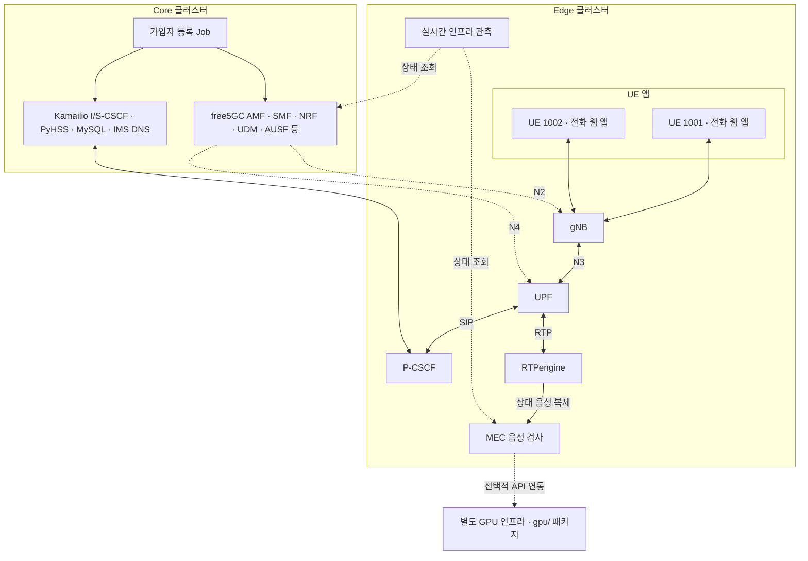

# free5GC Core·Edge·IMS KPT 패키지

Core·Edge 설정과 IMS 전화 데모를 배포하는 KPT 패키지다. GPU 노드·모델·체크포인트는 공개 CAPA 이미지와 사전 빌드 런타임을 사용하는 별도 `gpu/` 하위 패키지로 구성한다. 두 CNF 패키지의 주소 기본값은 새 ENI 주소표에 맞춘다. Core·Edge는 Porch에서 대상 Repository에 게시하고 ArgoCD가 Secret을 포함해 동기화한다. GPU 서비스는 관리 클러스터의 `gpu-services` 패키지가 Porch·Nephio로 전달한다.

새 Core·Edge 클러스터는 [CAPA·고정 ENI KPT 패키지](../infra/capa-free5gc/README.md)로 먼저 구성한다. ENI controller가 Core 3개·Edge 5개의 ENI를 예약한다. CAPA는 primary ENI로 노드를 만들고, ENI controller가 나머지를 지정한 device index에 연결한다. primary·secondary IP 할당, 원형 패키지 revision과 준비 절차는 해당 패키지에서 관리한다.

| 패키지 | 설치 대상 | 포함 사항 |
|---|---|---|
| `core/` | Core 클러스터 | free5GC 제어부·MongoDB·WebUI, IMS DNS·MySQL·I/S-CSCF·PyHSS, 5GC/IMS 가입자 등록 Job, 관측용 읽기 전용 RBAC. |
| `edge/` | Edge 클러스터 | UPF·gNB, 두 UE의 IMS 전화 앱·음성 변조·파일 송출·보관소, P-CSCF·RTPengine·MEC 음성 수집, 실시간 인프라 관측. |
| `gpu/` | 별도 GPU 클러스터 | 공개 Ubuntu 24.04 CAPA 이미지 기반 NVIDIA 준비·GPU 공유·Knative·모델 캡처/복원·RAM 캐시·GPU API/STT. |
| `edge/cert-manager/`, `edge/https/`, `edge/public/` | Edge 패키지에 포함 | 공개 NLB·HTTPS·인증서 발급·갱신과 내부 NodePort `31443`을 구성. |
| `edge/50-runtime-code.yaml` | Edge 클러스터 | 전화 앱·웹·MEC·관측 코드와 시험 WAV를 포함한 ConfigMap. |
| Docker Hub 공통 실행 이미지 | Core·Edge worker | 패키지의 고정 digest로 자동 다운로드. |

## 구조

## 설치 순서

Core·Edge·GPU 전체 순서와 병렬 구간은 [큰 패키지 단위 배포 다이어그램](../infra/capa-free5gc/docs/INSTALL.md#1-패키지-배포-순서)에 있다. AISRC 앱·모델·인증 파일은 **GPU 클러스터 준비 후, GPU 서비스 패키지 적용 전**에 주입한다. 그림과 표에서 별도 절차로 표시했다.

공통 실행 이미지는 Pod 생성 시 Docker Hub에서 자동으로 내려받는다.

Porch 게시·입력 절차는 [설치 절차](docs/INSTALL.md), 환경 값은 [설정 값 표](docs/PARAMETERS.md)에 있다. 외부 Python installer와 중복 templates는 사용하지 않는다.

음성 생성 기본값은 `gpu_local`이다. 관리 클러스터의 `gpu-bindings` 패키지가 GPU API 공개 주소와 토큰을 Edge Secret으로 전달하면 생성 WAV는 송신 UE로 반환돼 실제 통화 경로로 송출된다. 판별은 `inspection-enabled`로 활성화한다. ElevenLabs 키는 기본 경로에 사용하지 않는다.

GPU 패키지는 [GPU 설치 절차](gpu/README.md)를 따른다. 수정 런타임은 CAPA 부팅 중 고정된 바이너리 이미지에서 설치하고, AISRC 앱·모델·인증 파일은 별도 전달하여 주입한다.
