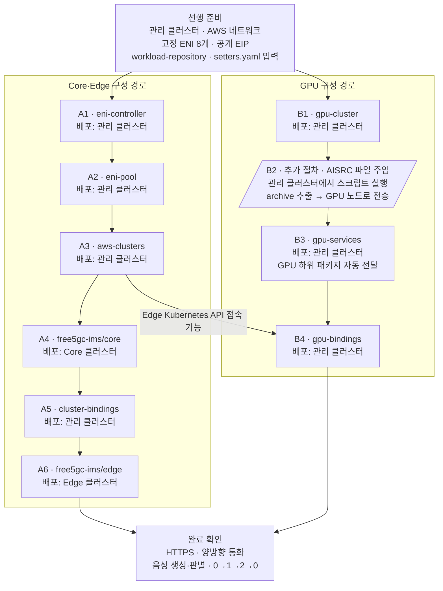

# Nephio 기반 Core·Edge 데모 클러스터 설치

## 1. 패키지 배포 순서

큰 패키지별 선행 관계를 표시했다. **각 영역은 화살표를 따라 독립적으로 진행**한다. 세로 화살표는 선행 작업의 완료가 필요하다는 뜻이고, 좌우 영역은 병렬로 진행할 수 있다. Edge 패키지는 `cluster-bindings` 다음에 게시한다. GPU 경로의 완료는 Edge 게시 조건이 아니라 전체 서비스의 최종 기동 확인 조건이다.



- **Core 경로:** `aws-clusters` 완료 후 `free5gc-ims/core`를 진행한다. GPU 노드·AISRC 파일 주입·GPU 모델 준비의 완료를 기다리지 않는다.
- **GPU 경로:** `gpu-cluster` 완료 후 AISRC 파일을 주입하고 GPU 서비스 패키지를 적용한다. Core 서비스 배포의 완료를 기다리지 않는다. GPU 클러스터 생성은 ENI controller·pool 설치와도 병렬로 진행할 수 있다.
- **Edge 게시:** `cluster-bindings` 다음에 `free5gc-ims/edge`를 게시한다. GPU 연결 Secret이 아직 없으면 이를 사용하는 UE·MEC·관측 워크로드는 대기한다. GPU 연결 뒤 자동 기동하므로 패키지를 다시 게시할 필요가 없다.
- **최종 합류:** Edge 패키지 게시와 `gpu-bindings`를 각각 진행한 뒤 Edge 서비스 Healthy·공개 인증서·실제 통화와 AI 기능을 함께 확인한다. GPU 연결 전에는 전화 웹 화면도 아직 준비되지 않을 수 있다.

| 구분 | 패키지·추가 절차 | 선행 완료 조건 | 적용 위치·완료 확인 |
|---|---|---|---|
| 선행 | 환경값·AWS 리소스·`workload-repository` 준비 | 관리 클러스터 접근과 AWS 권한. | 설치용 PC·AWS: VPC·subnet·NAT·경로·SG·ENI 8개·공개 접속 EIP 준비, 각 `setters.yaml` 입력. |
| A1 | `eni-controller` | 선행 준비. | 관리 클러스터: Controller와 ENIPool·ENIClaim CRD 준비. 이미 설치돼 있으면 생략. |
| A2 | `eni-pool` | A1: ENI controller·CRD 준비. | 관리 클러스터: 고정 ENI 8개 등록과 admission 정책 적용. |
| A3 | `aws-clusters` | A2: ENI pool 준비. | 관리 클러스터: Core·Edge Node Ready, 각 Git 저장소·CNI·ArgoCD·루트 Application 준비. |
| A4 | `free5gc-ims/core` | A3: Core 클러스터·GitOps 준비. | Core: Porch로 Secret을 포함한 전체 패키지 게시. Application Synced/Healthy, Core·IMS 기동과 가입자 Job Complete. |
| A5 | `cluster-bindings` | A4: Core 관측 자격 정보 준비. A3: Edge API 준비. | 관리 클러스터: Core API 주소·관측 자격 정보가 Edge에 전달되고 연결 Deployment Ready. |
| A6 | `free5gc-ims/edge` | A5: Core·Edge 연결 완료. | Edge: Porch로 Secret을 포함한 전체 패키지 게시. GPU 연결 전에는 관련 워크로드가 대기할 수 있으며, 이 단계에서 전체 Application Healthy를 기다리지 않고 GPU 경로를 계속 진행. |
| B1 | `gpu-cluster` | 선행 준비. | 관리 클러스터: GPU Node Ready, 드라이버·런타임·Flannel 준비. |
| B2 | **AISRC 파일 추출·주입** | B1: 새 GPU 노드 준비. | 관리 클러스터에서 스크립트 실행 → GPU 노드: archive의 `private/aisrc/`를 `/var/lib/voice-private/aisrc/`로 전송. `AISRC_TRANSFER_READY` 출력 확인. |
| B3 | `gpu-services` | B2: AISRC 파일 전송 완료. | 관리 클러스터: 다섯 PackageVariant 생성. Porch가 `mgmt-staging`에 게시하고 Nephio가 GPU로 전달. Job·Pod 내부에서 선행 준비를 기다려 모델·캐시·FaaS·API 구성. |
| B4 | `gpu-bindings` | B3: GPU API 준비. A3: Edge API 준비. | 관리 클러스터: GPU 공개 API 주소·접속 토큰이 Edge Secret에 전달되고 연결 Deployment Ready. |
| 확인 | 공개 화면·실제 서비스 확인 | A6: Edge 게시 완료. B4: GPU 연결 Ready. | Edge Application Synced/Healthy·공개 Certificate Ready=True 확인 후 브라우저에서 양방향 통화·음성 생성·판별과 실제 `0→1→2→0` 확인. |

### 패키지 배포 위치

| 단계 | 패키지·추가 작업 | 배포 클러스터 |
|---|---|---|
| A1 | `eni-controller` | 관리 클러스터. |
| A2 | `eni-pool` | 관리 클러스터. |
| A3 | `aws-clusters` | 관리 클러스터. |
| A4 | `free5gc-ims/core` | Core 클러스터. |
| A5 | `cluster-bindings` | 관리 클러스터. |
| A6 | `free5gc-ims/edge` | Edge 클러스터. |
| B1 | `gpu-cluster` | 관리 클러스터. |
| B2 | AISRC 파일 추출·주입. | 관리 클러스터에서 스크립트로 수행하는 추가 작업. GPU 노드로 파일 전송. |
| B3 | `gpu-services` | 관리 클러스터. GPU 하위 패키지는 Nephio가 GPU 클러스터로 전달. |
| B4 | `gpu-bindings` | 관리 클러스터. |

두 bindings Pod는 **관리 클러스터에서 실행되어 Core·Edge·GPU Kubernetes API에 접속**한다. 새 클러스터가 관리 클러스터로 역접속해 kubeconfig나 연결 정보를 가져오는 구조가 아니다.

### Porch 게시와 대상 적용

| 대상 | 게시·적용 경로 |
|---|---|
| 관리 패키지 | Porch의 `mgmt`에 게시 → 관리 클러스터에 적용. |
| Core·Edge 서비스 | `catalog-ims-demo`에서 대상 Repository로 복제·환경값 설정·게시 → Porch가 Git 반영 → 해당 클러스터의 ArgoCD가 Secret·워크로드 함께 적용. |
| GPU 서비스 | 관리 클러스터의 `gpu-services` PackageVariant → Porch가 다섯 하위 패키지를 `mgmt-staging`에 게시 → Nephio가 GPU Kubernetes API에 전달. |

GPU 모델 준비는 Job이 내부 조건을 확인하므로 하위 패키지 사이의 `kubectl wait`는 설치 절차에서 실행하지 않는다. Core·Edge Secret을 별도로 추출하거나 Git을 수동 commit·push하지 않는다. 자세한 게시 절차는 [서비스 설치 문서](../../../free5gc-ims/docs/INSTALL.md)에 있다.

### A3 → B4의 연결 의미

| 항목 | 처리 |
|---|---|
| Edge API | A3에서 생성한 Edge 클러스터의 Kubernetes API 서버. 전화·음성 서비스 API가 아님. |
| 접속 정보 | CAPA가 관리 클러스터에 만든 `<edge-cluster-name>-kubeconfig` Secret을 B4의 Pod가 자동 마운트. 기본 이름은 `edge-kubeconfig`. |
| B4의 작업 | GPU 공개 API 주소·토큰을 읽어 Edge의 `ims-lab`·`free5gc` namespace에 `ims-generation-gpu` Secret 생성·갱신. |
| 설치자 입력 | `gpu-bindings/setters.yaml`의 관리 namespace·Edge 클러스터 이름·GPU 클러스터 이름을 실제 배포값에 맞춤. API 주소·kubeconfig·토큰의 별도 수동 전달은 없음. |
| 대기 조건 | Edge Kubernetes API 접속 가능과 GPU API 준비. Edge UE·MEC·관측 앱의 Ready는 기다리지 않음. |

AISRC 주입에는 `$HOME/voice-studio-platform-internal-20261030.tar.gz`의 `voice-studio-platform/private/aisrc/`를 사용한다. `image.tar`, `runtime/pretrained/`, `runtime/client.env`, `runtime/DATA/license/`, `runtime/DATA/security/`, `machine-id`를 함께 전송한다. [GPU 설치 문서의 B2](../../../free5gc-ims/gpu/README.md#b2-aisrc-파일-전달)에 추출·전송 명령과 확인 출력이 있다. 파일 전송 뒤 GPU 패키지의 `20-platform`이 이미지 적재와 앱 설정 주입을 자동 처리한다. B2 실행 스크립트는 `infra/capa-free5gc/gpu-services/inject-aisrc.sh`다.

CNI와 ArgoCD는 대상 클러스터의 첫 Node Ready를 기다린 뒤 수동 설치하는 구조가 아니다. 관리 클러스터의 Nephio가 CAPA kubeconfig를 찾아 `mgmt-staging`의 Published 패키지를 적용한다. 루트 Application은 생성된 클러스터 Git 저장소를 계속 동기화한다.

Core·Edge·GPU 노드 생성은 병렬로 시작할 수 있다. 연결 컨트롤러는 상대 클러스터와 서비스의 준비를 재시도하며, Deployment 기동 기한은 60분이다. 모델 다운로드와 첫 캡처를 병렬로 기다리는 경우 연결 패키지의 `kpt live apply`에도 `--reconcile-timeout=60m`을 사용한다. Core 가입자 초기화와 Edge의 통신 경로 준비 조건은 각 워크로드의 초기화 단계에서 확인한다.

## 2. 선행 환경

| 항목 | 구성 |
|---|---|
| 관리 클러스터 | CAPI·CAPA·kubeadm providers, cert-manager, Porch, Nephio controller, Gitea, 관리 GitOps 동기화. |
| Porch Repository | `mgmt`, `mgmt-staging`, `catalog-distros-sandbox`, `catalog-nephio-core`, `catalog-nephio-optional`, `catalog-infra-capi`. |
| staging 설정 | `mgmt-staging`은 `deployment: false`, annotation `nephio.org/staging: "true"`. |
| 작업 머신 | kubectl·kpt·Docker. B2 파일 전송용 Python 3·tar·SSH. |
| AWS | VPC·Public/Private/N2/N3/N4/N6 subnet, 경로·SG·IAM profile·키 페어, 고정 ENI 8개. 주소표는 상위 README에 있다. |
| CPU 노드 | Kubernetes 1.32.0, Ubuntu 22.04 CAPA AMI `ami-045715a39cc1c8a78`, control-plane `t3.large`, worker `c5.4xlarge`, root 100 GiB. |
| GPU | `gpu-cluster`로 별도 노드 생성·모델 배포 후 `gpu-bindings`로 Edge 자동 연결. [GPU 순서](../../../free5gc-ims/gpu/README.md). |

Private subnet의 인터넷 경로는 NAT VM이 `running` 상태이고 IPv4 forwarding·MASQUERADE 설정이 완료된 뒤 등록한다. Worker 공용 보안 그룹에는 `kubernetes.io/cluster/core=shared`, `kubernetes.io/cluster/edge=shared` 태그를 설정한다. ENI 보존용 보안 그룹에는 이 태그를 설정하지 않는다.

```bash
kubectl --context management get repositories.config.porch.kpt.dev
kubectl --context management get repository.config.porch.kpt.dev mgmt-staging \
  -o jsonpath='{.metadata.annotations.nephio\.org/staging}{"\n"}{.spec.deployment}{"\n"}'
```

예상 값은 `true`, `false`다. Nephio와 Porch의 승인·게시 controller가 동작해야 PackageVariant에서 Published 패키지가 생성된다.

## 3. 패키지별 설정·배포 판단

Nephio WebUI에서 각 패키지를 복제하고, 수정 필요 항목만 `setters.yaml`에 입력한 뒤 렌더링·제안·승인·게시한다. 이미 준비된 선행 패키지는 다시 배포하지 않는다.

| 패키지 | 수정 필요 항목 | 기본값 유지 | 배포 판단 |
|---|---|---|---|
| `workload-repository` | 다른 카탈로그 URL·브랜치를 쓸 때만 변경. | `catalog-ims-demo`, `default`. | 카탈로그가 없을 때만 배포. |
| `eni-controller` | 기본 환경이면 없음. | 공개 controller 이미지·설정. | Controller·CRD가 없을 때만 배포. |
| `eni-pool` | VPC·SG ID, 고정 ENI ID 8개. | 172.31 주소 계획·연결 순서. | 새 ENI 묶음을 사용할 때 배포·갱신. |
| `aws-clusters` | 같은 VPC·SG·ENI ID, 공개·사설 subnet, 관리 Gitea 주소. 다른 키 페어를 쓰면 SSH 키 이름. | `core`, `edge`, worker IP·노드 이름·AMI·VM 사양. | Core·Edge 클러스터를 만들 때 배포. |
| `free5gc-ims/core` | 같은 주소 계획이면 없음. | Core·IMS·가입자·이미지. | Core 클러스터 준비 후 배포. |
| `cluster-bindings` | 없음. | `core`, `edge`. | Core 서비스 준비 후 배포. |
| `free5gc-ims/edge` | 웹 hostname·공개 subnet·EIP Allocation ID. | 통신 주소·UE·생성 경로. | `cluster-bindings` 후 배포. |
| `gpu-cluster` | VPC·공개 subnet ID. 다른 키 페어를 쓰면 SSH 키 이름. | `demo-gpu-a`, L4 사양·공개 AMI·버전. | Core·Edge와 병렬 배포. |
| AISRC 파일 전달 | archive·SSH 키 경로. | GPU 이름·namespace. | GPU Node Ready 후 B2 스크립트 1회 실행. |
| `gpu-services` | 같은 카탈로그이면 없음. | GPU 이름·하위 패키지·버전. | 파일 전송 후 배포. |
| `gpu-bindings` | 없음. | `edge`, `demo-gpu-a`. | GPU 서비스 게시 후 배포. |

- Core·Edge 서비스의 단계별 설정과 완료 조건: [Core·Edge 서비스 배포](../../../free5gc-ims/docs/INSTALL.md).
- GPU의 단계별 설정과 B2 실행 명령: [GPU 클러스터·서비스 배포](../../../free5gc-ims/gpu/README.md).
- ENI IP·역할·primary·secondary 주소: [주소표](../README.md).

관리 클러스터 패키지를 로컬 명령으로 배포하는 경우의 공통 형식은 다음과 같다. Core·Edge 서비스는 위의 Porch 게시 방식으로 배포한다.

```bash
# aws-clusters 예시: 작업 복사본의 setters.yaml에서 표의 항목만 수정.
kpt fn render ./aws-clusters
kpt live init ./aws-clusters --namespace default
kpt live apply ./aws-clusters --reconcile-timeout=60m
```
